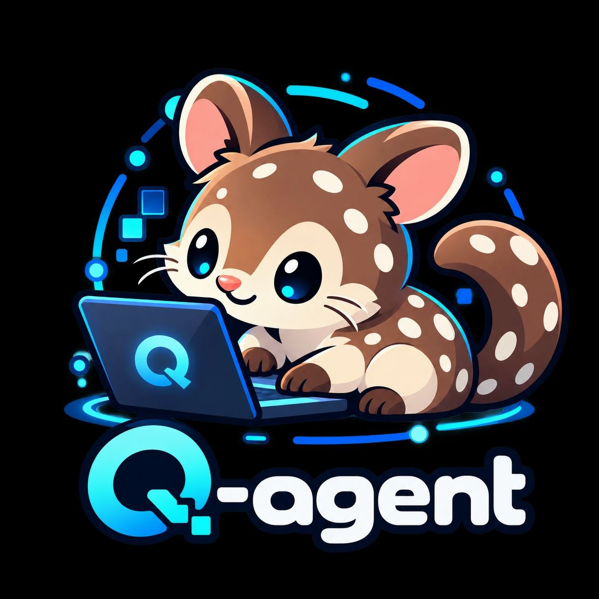

<div align="center">



### Your own AI agent. Right inside Telegram.

Ask questions, work with files, and schedule tasks — without leaving the chat.

[](https://github.com/DemonGiggle/q-agent/actions/workflows/ci.yml)
[](https://go.dev/dl/)
[](https://core.telegram.org/bots)
[](#quick-start)
[](LICENSE)

[Quick start](#quick-start) · [Highlights](#highlights) · [Telegram](#telegram-commands) · [Command line](#command-line) · [Docs](#docs)

</div>

---

q-agent is a self-hosted assistant you talk to through Telegram. Connect your
preferred model, choose who can use it, and give it tasks in plain language.
It works with files and commands on your Linux host and brings the result back
to the chat.

## Highlights

### 🪶 Tiny footprint

All the agent, none of the bloat:

- **Featherweight:** one static binary that idles under ~20 MB — confirm with
  `/status` anytime.
- **Runs anywhere:** happy on a small VPS or Raspberry Pi, with no runtime
  dependencies to babysit.
- **Stays out of your way:** installs as a systemd user service and just runs.
  See [systemd deployment](docs/systemd.md).

### 📦 Native sandbox, no Docker

Let it do real work — without handing over the keys:

- **Truly isolated:** each chat gets its own Debian world, powered by
  bubblewrap (just needs `bubblewrap` installed; on Debian, `uidmap` /
  `mmdebstrap` build the image).
- **Credentials stay out:** your keys live on the host and never enter the
  sandbox.
- **Honest by design:** if isolation can't be guaranteed, it stops instead of
  silently running unprotected. Fast host mode stays the default for speed.
  See [host vs sandbox](docs/operations.md#2-how-tools-run-host-vs-sandbox).

### 👋 Companion mode, on by default

Your agent doesn't just wait to be asked — it looks out for you:

- **It reaches out first:** a gentle reminder, a word of encouragement, or a
  timely suggestion, grounded in your recent conversations and memory.
- **Quiet by nature:** it knows silence is usually the right answer, and never
  interrupts when you're busy or recently active.
- **On your terms:** tune it per chat from `/companion`, or turn it off
  entirely.

Full rules in [operations](docs/operations.md#3-talking-to-the-bot).

## More features

- Telegram: private chats, groups (mention or reply), topics with separate histories.
- Models: Ollama, OpenAI, OpenCode Go, ChatGPT subscription; per-chat `/provider`, `/model`, `/think`, `/max_steps`.
- Tools: `read`, `list`, `search`, `write`, `edit`, `shell` with capped output.
- Web: `web_search` (DuckDuckGo, no key), `web_fetch` (text-only, no JS/login).
- Schedules: one-time reminders and daily/weekly agent tasks by asking; list/delete in chat.
- Memory: short-term context per topic plus nightly notes per chat (`/memory`, `/forget`).
- Photos & files: photos (up to 2 per message, 10 MB each) and documents, video, audio, voice saved to `inbox/` for vision + tools (5 files, 20 MB each, 100 MB per chat, cleared daily).
- Interactive sessions: PTY/pipe process sessions (`shell` + `process`), incl. login flows.
- Control: live `Working…` progress, steer running tasks with follow-up text, `/cancel`, `/new`.
- MCP: optional external tool servers over stdio or Streamable HTTP (off by default) — [details](#mcp-servers-optional).
- Console: guided `models` / `config` menus plus script-friendly `--json` actions.
- Service: systemd user unit, `q-agent update`, Telegram `/update` + `/restart` (admin only).

## MCP servers (optional)

q-agent can call tools from external [Model Context Protocol](https://modelcontextprotocol.io)
servers — as an MCP *client* (it never serves its own tools over MCP). Off by
default; configure in `config.toml`, then **restart** the service (no live reload):

```toml
[mcp.servers.local-tools]
enabled = true
transport = "stdio"          # or "http"
command = "/usr/local/bin/mcp-server"
args = ["--stdio"]
# url = "https://mcp.example.com/mcp"   # http only; https anywhere, http loopback-only
```

- **Install for the right mode.** `stdio` commands resolve in the task's
  environment: on the host for host mode, *inside the chat's Debian image*
  for sandbox mode (the sandbox cannot see host paths). A sandbox failure
  never falls back to host execution — the server just shows unavailable.
- **Shared everywhere.** Every authorized chat — and every scheduled agent
  task — gets the same enabled servers, dialed fresh per task and released
  on completion, cancellation, timeout, or shutdown. Enabling a server
  trusts all authorized chats with its tools; there is no per-chat scoping
  or per-call approval. Tools appear as `server__tool`; results are
  untrusted third-party data.
- **Troubleshooting.** The service log prints one line per task, e.g.
  `mcp: 1/2 servers available, 5 tools, 0 quarantined`, and the chat
  prompt lists unavailable servers with a one-line reason. Commands, URLs,
  and environment never appear in logs or errors. If a server is
  unavailable, check it is reachable from the task's mode and that you
  restarted after saving the config.
- **Not supported:** standalone resources/prompts, roots, sampling,
  elicitation, OAuth/credential storage, custom headers, secret injection
  into environments, legacy HTTP+SSE transport, and bundled server
  binaries. See the `[mcp]` comments in
  [config.example.toml](config.example.toml).

## Quick start

Needs **Linux**, **Go 1.27+**, **Git**, **Make**, a bot token from [@BotFather](https://t.me/BotFather), and a model provider (example config uses Ollama with `qwen3`).

```sh
git clone https://github.com/DemonGiggle/q-agent.git
cd q-agent
make build
mkdir -p ~/.config/q-agent
cp config.example.toml ~/.config/q-agent/config.toml
```

Edit `~/.config/q-agent/config.toml` to pick your provider/model and set
`allowed_users` / `allowed_groups`, then:

```sh
export TELEGRAM_BOT_TOKEN='your BotFather token'
./bin/q-agent serve
```

Open your bot in Telegram and try `/status` or `/help`. In groups, disable
privacy via BotFather and mention the bot.

## Telegram commands

| Command | What it does |
| --- | --- |
| `/status`, `/help` | Show setup snapshot · list commands |
| `/models`, `/provider`, `/model`, `/think`, `/max_steps`, `/settings` | View or switch this chat's model setup |
| `/memory`, `/forget`, `/companion` | View memory · clear notes · tune check-ins |
| `/new`, `/cancel` | Fresh conversation · stop the running task |
| `/update`, `/restart` | Admin-only service update/restart |

Full behavior — addressing, photos & files, steering, schedules, memory, admin setup —
is in [talking to the bot](docs/operations.md#3-talking-to-the-bot).

## Command line

The same binary also runs the bot, edits settings, manages the service, and
self-updates — all from your shell.

See the [command line overview](docs/cli.md) for what each command is for.

## Docs

| Guide | Covers |
| --- | --- |
| [Command line overview](docs/cli.md) | Every `q-agent` command and where its details live |
| [Configuration & operations](docs/operations.md) | Providers, credentials, host vs sandbox, tools, schedules, memory, companion, state, upgrades |
| [Memory](docs/memory.md) | How discussions are remembered, distilled, retrieved |
| [Context composition](docs/context.md) | Prompt order, tool placement, cache guidance |
| [systemd deployment](docs/systemd.md) | Install, start, sandbox rules, `/restart` & `/update`, removal |
| [Console guide](docs/console.md) | Guided `models` / `config` menus and script-friendly actions |
| [Example configuration](config.example.toml) | All settings in one place |
| [Validation notes](docs/VALIDATION.md) | Test coverage and measured limitations |

---

Built from [qcode](NOTICE), with its MIT attribution retained.
[MIT licensed](LICENSE). Self-hosted. Yours to run.
